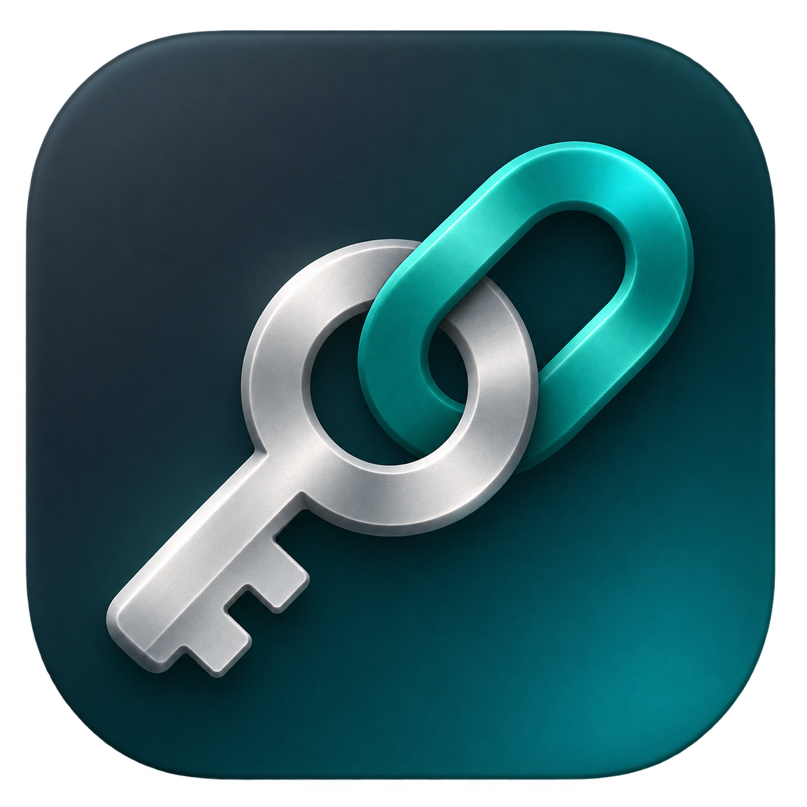

<p align="center">
  
</p>

# Keychain Compatibility Layer

[English](README.md) | [한국어](README.ko.md) | [简体中文](README.zh-CN.md) | [日本語](README.ja.md)

Codex のリモート制御用デバイス鍵の作成エラーに対応する macOS 互換レイヤーです。
Codex の元のアプリを変更・コピーせず、ソフトウェアによるキーチェーン保存と接続します。

**Codex の自動互換処理と Secretive 用の独立した SSH キーに対応します。**
Secretive の原本を変更せず、CryptoTokenKit のスマートカード経由で接続します。
すべてのアプリのキーチェーンや Secure Enclave ハードウェアを置き換えるものではありません。

## 対応アプリ

| アプリ | 機能 | 検証バージョン |
| --- | --- | --- |
| Codex | デバイスキー作成の互換処理 | 26.1111.21308 |
| Secretive | SSH キー作成・署名 | 4.0.0 |

検証環境：macOS 26.7.3（Intel）。現在の KCL：0.5.1。
Secretive 用キーは KCL で作成し、署名時は二度の認証が必要です。
[検証記録と制約](docs/VERIFICATION.md)。

## パッケージ構成

| パッケージ | 役割 |
| --- | --- |
| `native/core/` | キー保存・認証・署名 |
| `native/integrations/codex/` | Codex の自動互換処理 |
| `native/integrations/secretive/` | Secretive 用 SSH キー |

アプリと DMG は一つにまとめて配布します。[詳細構成](docs/ARCHITECTURE.md)。

## 使用する場合

```text
Secure Enclave key creation failed
OS-protected fallback failed
OSStatus error -25293
```

**Codex のリモート制御の承認時にデバイス鍵の作成が失敗し、上記のログが
確認できる場合に使用します。** 古い macOS では `-25300` が報告される
場合もあります。エラー番号だけで判断せず、リモート制御用のデバイス鍵を
作成する処理で発生したエラーかどうかを確認してください。

主に、T2 チップを搭載していない古い Intel Mac や Hackintosh など、
Secure Enclave を利用できない環境が対象です。**すべての Intel Mac や
Hackintosh に必要なツールではありません。** 現在のランタイム統合は
Intel（`x86_64`）macOS 向けです。これらは影響を受ける可能性がある環境の
例であり、すべての機種・OS・アプリのバージョンで検証済みという意味ではありません。

**次の場合は使用する必要がありません。**

- Codex のリモート制御の承認が正常に動作している場合。
- アカウントやワークスペースの不一致、ネットワーク、管理者ポリシーなど、
  デバイス鍵の作成とは無関係な原因で接続に失敗している場合。
- 汎用的なキーチェーン修復、Touch ID、ハードウェア証明、または
  Secure Enclave ハードウェア自体の代替が必要な場合。

このレイヤーは Codex の特定のソフトウェア鍵操作を補完するもので、
すべてのアプリのキーチェーンアクセスを置き換えるものではありません。
必要なブラウザーでの承認と macOS の認証は、引き続き手動で行ってください。
公式アップデートで問題が修正された場合は、このレイヤーを無効にして
正常に承認できることを確認してから、使用を終了してください。

## ダウンロードとインストール

このリポジトリの GitHub **[Releases](https://github.com/hoyaaaa/keychain-compatibility-layer/releases)** から、**ビルド済みの Intel macOS 用 DMG** を
ダウンロードしてください。利用者による **Homebrew・Go・Python・Xcode の導入や
ソースビルドは不要**です。ファイル名は
`Keychain-Compatibility-Layer-0.5.1-macOS-x86_64.dmg` で、対応する `.sha256` も提供します。
現在は Intel macOS 向けで、Apple Silicon を含むユニバーサルビルドではありません。

1. DMG をダウンロードして開きます。
2. 中の **Keychain Compatibility Layer.app** を開き、**Install / 설치** をクリックします。
3. インストールされたアプリが自動適用を開始します。メニューバーに **KCL** が表示され、アプリを起動したままにします。
4. DMG を取り出します。以後は通常の Codex アイコンで起動します。

アプリは `~/Applications/Keychain Compatibility Layer.app` にインストールされます。
署名検証、一時コピー、失敗時の復元、既存キーの保持を行います。
自動適用は本アプリの実行中のみ動作し、独立したログインサービスや有効化スイッチはありません。実行中の Codex は維持します。
次回通常起動した Codex を一度正常に再起動して互換レイヤーを読み込みます。
必要なブラウザ承認と macOS 認証は利用者が完了してください。

**初回起動：**このテスト用プレリリースはアドホック署名のみで、**Apple の公証を受けていない**ため、macOS が警告を表示したり、起動を阻止したりする場合があります。ダウンロードしたアプリを信頼できる場合は、一度起動して警告を閉じ、**システム設定 → プライバシーとセキュリティ → このまま開く**を選びます。認証後、確認画面で**開く**をクリックしてください。[Apple の案内](https://support.apple.com/ja-jp/102445)。

## Secretive 用 SSH キーの作成

1. KCL を開き、メニューの **Create SSH key for Secretive… / SSH 키 만들기…** を選びます。
2. 名前を入力すると、独立したソフトウェア RSA-2048 キーを作成し、公開キーをコピーできます。
3. 原版 Secretive を開くか再起動すると、スマートカード欄にキーが表示されます。
4. Secretive の案内に従って SSH エージェントのソケットを設定します。署名時には macOS 認証が必要です。

Secretive の Secure Enclave 用作成ボタンは変更しません。ソフトウェアキーは KCL で作成します。
Codex の P-256 デバイスキーは再利用・交換しません。Secretive が最初のトークンだけを選ぶ制約に合わせ、
KCL の公開キーは一つのトークンにまとめます。他の KCL キーも表示されるため、SSH には **SSH — …** のみを使用してください。
別のスマートカードが選ばれた場合は、そのカードを外して Secretive を再起動してください。

現在の連携は Secretive が対応する **RSA-2048 / RSA-SHA2-512** を使用します。
公開キーの `ssh-rsa` はキー形式の名前で、SHA-1 署名を有効にする意味ではありません。
検証した Secretive では ECDSA スマートカード SSH 署名の検証が失敗したため、この経路では生成しません。
Secure Enclave、Touch ID、ハードウェア保護は再現しません。[技術説明（英語）](docs/SECRETIVE.md)。

**現在の制約：**Secretive と KCL が個別に認証するため、署名時にパスワードを二度求める場合があります。本バージョンは両方の確認を維持します。

## 更新と無効化

新しい DMG のアプリを開き、再度 **Install / 설치** をクリックして更新します。
以前のアプリ、既存キー、自動適用サービスの実行状態を保持します。完了後に DMG を取り出してください。

メニューバーで **KCL → Quit / 종료** を選ぶと自動適用を停止します。その後 Codex を完全終了して通常起動すると、レイヤーの使用を停止できます。
保存済みキーと Codex の原本は保持されます。アプリの強制終了時も監視は停止し、再起動すると再開します。Codex に読み込まれたコードは Codex の終了まで残ります。

## 開発とリリース

バージョン **0.5.1** は `VERSION` で管理します。一致する `v0.5.1` タグを
管理者がプッシュすると、CI がバージョン確認、テスト、DMG のビルドと検証を行い、
DMG と SHA-256 を GitHub のテスト用プレリリースにアップロードします。
手動実行では CI アーティファクトのみを作成し、Release は公開しません。

ビルド・テスト・リリース手順は[貢献ガイド（英語）](CONTRIBUTING.md)、任意の診断は
[技術文書（英語）](docs/TECHNICAL.md)、変更点は[変更履歴](CHANGELOG.md)を参照してください。
実行ファイル、Bundle ID、クラス名、実行時パスも Keychain Compatibility Layer / KCL に統一しました。移行時は公開キーの同一性を検証します。旧識別子は移行処理だけで使用し、旧暗号化キー項目は復元用に保持します。旧名前空間から更新した後は Codex を完全終了して再起動してください。

[MIT ライセンス](LICENSE) · [貢献ガイド（英語）](CONTRIBUTING.md)
