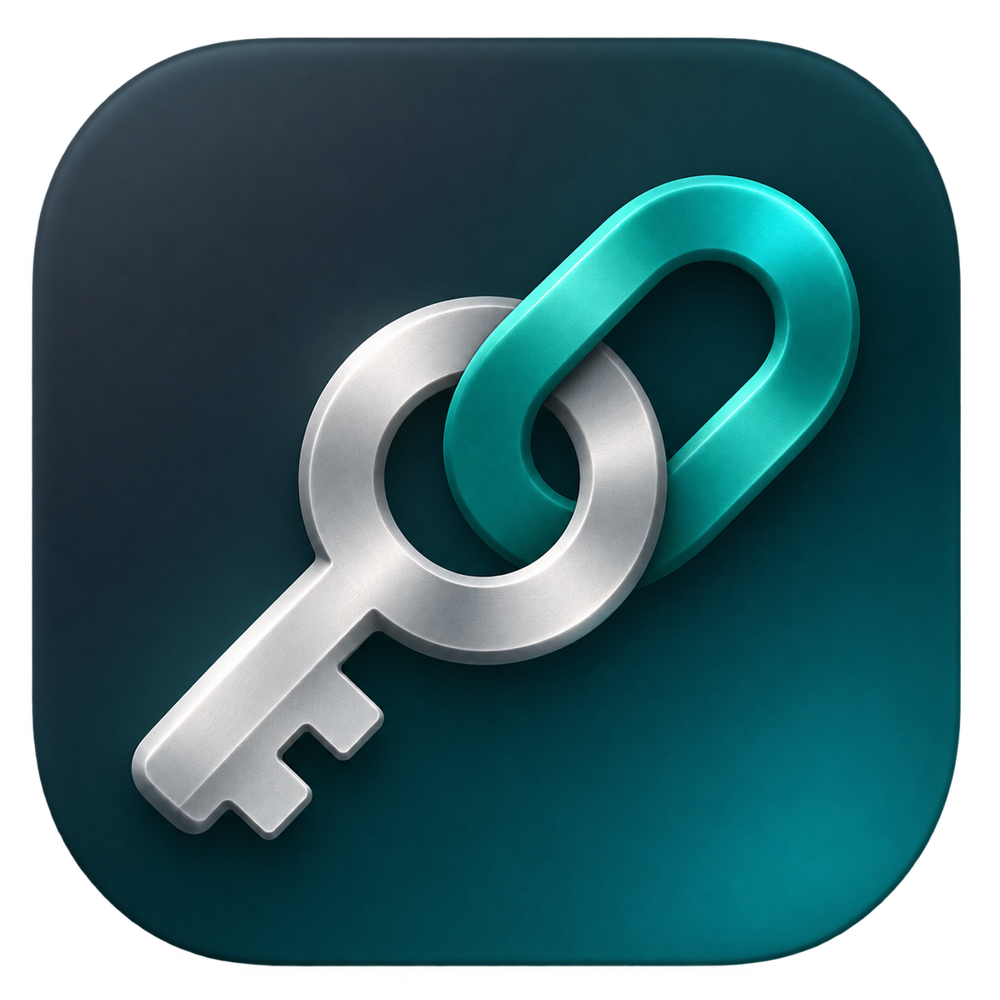

<p align="center">
  
</p>

# Keychain Compatibility Layer

[English](README.md) | [한국어](README.ko.md) | [简体中文](README.zh-CN.md) | [日本語](README.ja.md)

Codex 원격 제어용 기기 키 생성 오류를 해결하는 macOS 호환 계층입니다.
Codex 원본을 수정하거나 복사하지 않고 소프트웨어 키체인 저장소와 연결합니다.

**현재 지원 경로는 Codex 자동 호환과 Secretive용 SSH 키 연동입니다.**
Secretive 원본은 수정하지 않고 CryptoTokenKit 스마트카드 경로로 별도 SSH 키를 제공합니다.
모든 앱의 키체인 접근이나 Secure Enclave 하드웨어를 대체하는 도구는 아닙니다.

## 지원 앱

| 앱 | 지원 기능 | 검증 버전 |
| --- | --- | --- |
| Codex | 기기 키 생성 호환 | 26.1111.21308 |
| Secretive | SSH 키 생성·서명 | 4.0.0 |

검증 환경: macOS 26.7.3 (Intel). 현재 KCL: 0.5.1.
Secretive용 키는 KCL에서 만들며, 서명 시 인증이 두 번 필요합니다.
[상세 검증 기록과 제한 사항](docs/VERIFICATION.md)은 별도 문서에 정리했습니다.

## 패키지 구조

| 패키지 | 역할 |
| --- | --- |
| `native/core/` | 키 저장·인증·서명 |
| `native/integrations/codex/` | Codex 자동 호환 |
| `native/integrations/secretive/` | Secretive용 SSH 키 |

배포는 하나의 앱·DMG로 제공합니다. [상세 구조](docs/ARCHITECTURE.md).

## 언제 사용하나요

```text
Secure Enclave key creation failed
OS-protected fallback failed
OSStatus error -25293
```

**Codex 원격 제어 승인 중 기기 키 생성이 실패하고, 위 로그 패턴이 확인될
때 사용합니다.** 일부 구형 macOS에서는 `-25300`으로 나타나기도 합니다.
오류 번호만으로 판단하지 말고, 원격 제어용 기기 키 생성 과정에서 발생한
오류인지 함께 확인하세요.

주로 Secure Enclave를 사용할 수 없는 환경, 예를 들어 T2 칩이 없는 구형
Intel Mac이나 해킨토시에서 발생합니다. **모든 Intel Mac·해킨토시에 필요한
도구는 아닙니다.** 현재 런타임 통합 대상은 Intel(`x86_64`) macOS입니다.
위 예시는 영향을 받을 수 있는 환경이며, 모든 기종·OS·앱 버전의 동작을
검증했다는 의미는 아닙니다.

**다음 경우에는 사용하지 않아도 됩니다.**

- Codex 원격 제어 승인이 정상적으로 동작합니다.
- 계정·워크스페이스 불일치, 네트워크, 관리자 정책 등 기기 키 생성과 관계없는
  원인으로 연결이 실패합니다.
- 일반적인 키체인 복구, Touch ID, 하드웨어 증명 또는 Secure Enclave 하드웨어
  자체를 대체하는 도구가 필요합니다.

이 레이어는 Codex의 특정 소프트웨어 키 작업을 호환 처리하며, 모든 앱의
키체인 접근을 대체하지 않습니다. 필요한 웹 승인과 macOS 인증은 직접
완료해야 합니다. 공식 앱 업데이트로 문제가 해결되면 이 우회 기능을 끄고
정상 승인이 되는지 확인한 뒤 사용을 중단하세요.

## 다운로드 및 설치

이 저장소의 GitHub **[Releases](https://github.com/hoyaaaa/keychain-compatibility-layer/releases)**에서 **미리 빌드된 Intel macOS용 DMG**를
다운로드하세요. 사용자는 **Homebrew·Go·Python·Xcode 설치나 소스 빌드가 필요 없습니다.**
파일 이름은 `Keychain-Compatibility-Layer-0.5.1-macOS-x86_64.dmg`이며,
검증용 `.sha256` 파일도 제공합니다. 현재는 Intel macOS용으로, Apple Silicon을
포함한 범용 빌드가 아닙니다.

1. DMG를 다운로드해 엽니다.
2. 안의 **Keychain Compatibility Layer.app**을 열고 **Install / 설치**를 누릅니다.
3. 설치된 앱이 바로 자동 적용을 시작합니다. 메뉴 막대에 **KCL**이 표시되며 앱을 실행해 두면 됩니다.
4. DMG를 추출하고, 다음부터 평소 Codex 아이콘으로 실행합니다.

앱은 `~/Applications/Keychain Compatibility Layer.app`에 설치됩니다.
설치 시 서명을 검사하고 임시 복사·실패 복구·기존 키 보존을 처리합니다.
별도 켜기·끄기 설정이나 독립 로그인 서비스 없이, 앱이 켜져 있는 동안 자동 적용됩니다. 이미 실행 중인 Codex는 그대로 두며,
이후 평소 아이콘으로 새로 실행할 때 호환 계층을 붙여 한 번 정상 재시작합니다.
필요한 브라우저 승인과 macOS 인증은 직접 완료해야 합니다.

**첫 실행 안내:** 이 테스트용 프리릴리스는 임시 서명만 있으며 **Apple 공증을 받지 않아** macOS가 경고하거나 실행을 차단할 수 있습니다. 다운로드한 앱을 신뢰한다면 한 번 실행한 뒤 경고를 닫고, **시스템 설정 → 개인정보 보호 및 보안 → 그래도 열기**를 누르세요. 인증 후 확인 창에서 **열기**를 선택하면 됩니다. [Apple 안내](https://support.apple.com/ko-kr/102445).

## Secretive용 SSH 키 만들기

1. KCL을 열고 메뉴의 **Create SSH key for Secretive… / SSH 키 만들기…**를 선택합니다.
2. 이름을 입력하면 별도 소프트웨어 RSA-2048 키를 만들고 공개키를 복사할 수 있습니다.
3. 원본 Secretive를 열거나 재실행하면 스마트카드 항목에 키가 표시됩니다.
4. Secretive 안내에 따라 SSH 클라이언트를 해당 에이전트 소켓에 연결합니다.
   서명할 때는 macOS 사용자 인증을 완료해야 합니다.

Secretive의 기존 Secure Enclave **키 생성 버튼은 그대로**입니다. 이 소프트웨어 키는
KCL 메뉴에서 생성하세요. 기존 Codex용 P-256 기기 키를 재사용하거나 교체하지 않습니다.
Secretive가 첫 토큰만 선택하는 제약에 맞춰 KCL 공개키를 하나의 토큰 저장소에 모읍니다.
다른 KCL 키도 표시될 수 있으므로 SSH에는 **SSH — …** 이름의 키만 사용하세요.
다른 스마트카드가 연결돼 Secretive가 그 카드를 선택하면 해당 카드를 분리하고 재실행하세요.

현재 연동은 Secretive의 지원 목록에 맞춘 **RSA-2048 / RSA-SHA2-512**입니다.
공개키 줄의 `ssh-rsa`는 키 인코딩 이름이며 SHA-1 서명을 활성화한다는 뜻이 아닙니다.
검증한 Secretive 빌드에서는 ECDSA 스마트카드 SSH 서명 검증이 실패해 해당 경로로는 생성하지 않습니다.
Secure Enclave 하드웨어·Touch ID 지원·하드웨어 보호를 흉내 내지는 않습니다.
[연동 기술 문서(영어)](docs/SECRETIVE.md)를 참고하세요.

**현재 제한:** Secretive와 KCL이 각각 인증하므로 서명 시 암호를 두 번 물을 수 있습니다. 이 버전은 두 검사를 유지하며 인증을 생략하지 않습니다.

## 업데이트 및 비활성화

업데이트는 새 DMG의 앱을 열고 **Install / 설치**를 다시 누르면 됩니다.
이전 앱과 기존 키를 보존하며, 자동 적용 서비스의 기존 실행 상태도 유지합니다.
설치가 끝나면 DMG를 추출하세요.

끄려면 메뉴 막대에서 **KCL → Quit / 종료**를 선택하세요. 이후 Codex를 완전히 종료하고 평소 아이콘으로 다시 실행하면 됩니다.
저장된 키와 Codex 원본은 유지됩니다. 앱을 강제 종료해도 감시가 중단되고, 앱을 다시 열면 자동 적용이 시작됩니다. 이미 Codex에 로드된 코드는 Codex를 종료할 때까지 남습니다.

## 개발 및 릴리스

버전 **0.5.1**은 `VERSION`에서 관리합니다. 관리자가 일치하는 `v0.5.1` 태그를
푸시하면 CI가 버전 검사·테스트·DMG 빌드와 검증을 수행하고, DMG와 SHA-256을
GitHub 테스트용 프리릴리스에 올립니다. 수동 워크플로 실행은 공개 릴리스 없이
CI 아티팩트만 생성합니다.

빌드·테스트·릴리스 절차는 [기여 안내(영어)](CONTRIBUTING.md), 선택적인 진단은
[기술 문서(영어)](docs/TECHNICAL.md), 변경 사항은 [변경 이력](CHANGELOG.md)을
참고하세요. 실행 파일·번들 ID·클래스·저장 경로도 Keychain Compatibility Layer / KCL로 통일했습니다. 업데이트 시 기존 키의 공개키가 같은지 검증해 이관합니다. 과거 식별자는 이관 코드에만 남으며 이전 암호화 키 항목은 복구용으로 보존합니다. 이전 버전에서 업데이트한 뒤 Codex를 완전히 종료하고 다시 실행하세요.

[MIT 라이선스](LICENSE) · [기여 안내(영어)](CONTRIBUTING.md)
