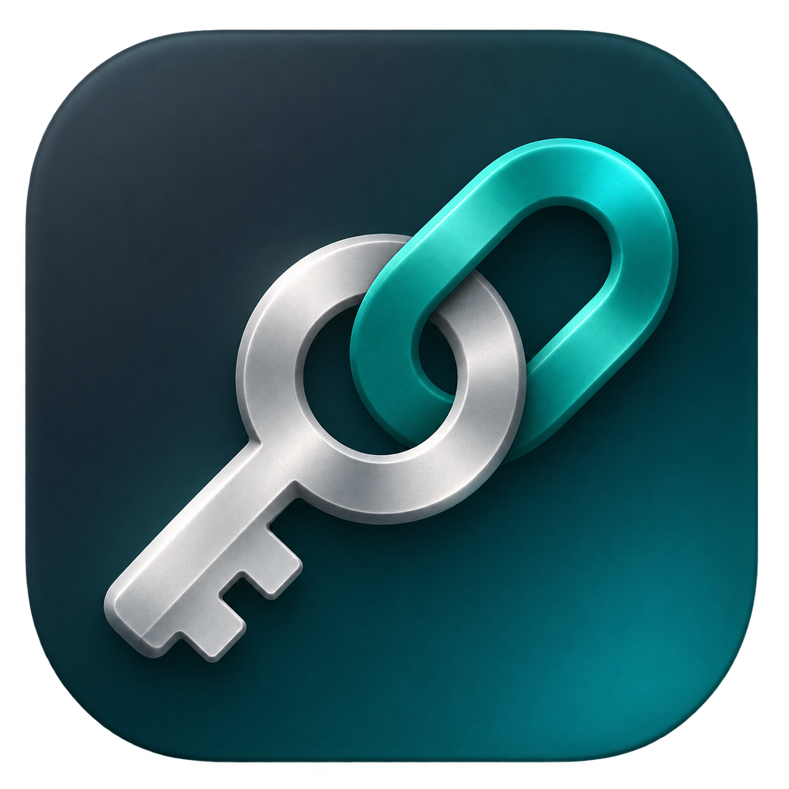

<p align="center">
  
</p>

# Keychain Compatibility Layer

[English](README.md) | [한국어](README.ko.md) | [简体中文](README.zh-CN.md) | [日本語](README.ja.md)

A macOS compatibility layer for Codex Remote Control device-key failures. It
connects Codex to software-backed Keychain storage without modifying or copying
the original Codex application.

**Supported paths:** automatic device-key compatibility for Codex, and separate
software SSH keys exposed to unmodified Secretive through CryptoTokenKit.
This is not a general replacement for Secure Enclave or every app's Keychain access.

## Supported apps

| App | Support | Tested version |
| --- | --- | --- |
| Codex | Device-key compatibility | 26.1111.21308 |
| Secretive | SSH key creation and signing | 4.0.0 |

Test environment: macOS 26.7.3 (Intel). Current KCL: 0.5.1.
Secretive keys are created in KCL; signing requires two authentication prompts.
See [test details and limits](docs/VERIFICATION.md).

## Packages

| Package | Role |
| --- | --- |
| `native/core/` | Key storage, authentication and signing |
| `native/integrations/codex/` | Codex automatic compatibility |
| `native/integrations/secretive/` | Secretive SSH keys |

Distributed as one app and DMG. [Architecture details](docs/ARCHITECTURE.md).

## When to use

```text
Secure Enclave key creation failed
OS-protected fallback failed
OSStatus error -25293
```

**Use this layer when Codex Remote Control authorization fails while creating
its device key**, and the logs contain the failure chain above. Some older
macOS versions report `-25300` instead. An error number alone is not sufficient:
confirm that it occurs in the Remote Control device-key creation path.

This typically affects environments where Secure Enclave is unavailable, such
as older Intel Macs without a T2 chip and Hackintosh systems. It is **not a
requirement for every Intel Mac or Hackintosh**. The current runtime integration
targets Intel (`x86_64`) macOS; the examples are affected environments, not a
guarantee that every model, OS or app version has been tested.

**You do not need this layer if:**

- Codex Remote Control authorization already works normally.
- The failure is caused by account/workspace mismatch, network connectivity,
  administrator policy, or another issue unrelated to device-key creation.
- You need a general Keychain repair tool, Touch ID support, hardware
  attestation, or a replacement for Secure Enclave hardware.

It handles specific Codex software-key operations, not every application's
Keychain access. Required browser approvals and macOS authentication still apply.
If an official app update resolves the failure, disable this workaround and
verify normal authorization before continuing without it.

## Download and install

Use the **prebuilt Intel macOS DMG** from this repository's GitHub **[Releases](https://github.com/hoyaaaa/keychain-compatibility-layer/releases)**
section. No Homebrew, Go, Python, Xcode or source build is required to use it.
The release asset is named `Keychain-Compatibility-Layer-0.5.1-macOS-x86_64.dmg`;
a matching `.sha256` file is provided. This targets Intel macOS, not a universal
Apple Silicon build.

1. Download and open the DMG.
2. Open **Keychain Compatibility Layer.app** inside it and click **Install / 설치**.
3. The installed app starts automatic application immediately; keep it running (the **KCL** menu appears in the menu bar).
4. Eject the DMG and use the normal Codex icon for future launches.

The app installs itself at `~/Applications/Keychain Compatibility Layer.app`
with signature checks, staging, rollback and preservation of existing keys.
The app owns the helper; there is no separate enable/disable setting or independent login helper. It leaves already-running Codex processes alone;
a subsequent normal Codex launch is gracefully restarted once with the layer.
Required browser approval and macOS authentication must still be completed.

**First launch:** This test prerelease is ad-hoc signed and **not notarized by Apple**, so macOS may warn or block it. If you trust this download, try opening the app once, dismiss the warning, then go to **System Settings → Privacy & Security → Open Anyway**. Authenticate and click **Open** when prompted. [Apple’s instructions](https://support.apple.com/en-us/102445).

## Secretive SSH keys

1. Open KCL and choose **Create SSH key for Secretive… / SSH 키 만들기…** in its menu.
2. Enter a name. KCL creates a separate software RSA-2048 key and lets you copy its public key.
3. Open or restart the original Secretive app. The key appears in its smart-card section.
4. Configure your SSH client with Secretive's agent socket using Secretive's own instructions.
   Signing still requires macOS owner authentication.

Secretive's original Secure Enclave **Create** button remains unchanged; use KCL
for these software keys. Codex's existing P-256 device keys are not reused or
rotated. Public keys share one token store so Secretive's single-token selection
does not hide KCL SSH keys. Other KCL keys may also be visible; use only keys named
**SSH — …** for SSH. With other smart cards connected, Secretive may choose a
non-KCL card; disconnect that card and restart Secretive to use the KCL store.

This integration uses RSA-2048 with **RSA-SHA2-512**, matching Secretive's supported
smart-card algorithms. `ssh-rsa` in the public-key line names the key encoding;
SHA-1 signatures are not enabled. ECDSA smart-card SSH signatures currently fail
verification in the tested Secretive build, so KCL does not generate them for
this path. Secure Enclave hardware, Touch ID availability and hardware-backed
security guarantees are not emulated. See [Secretive integration details](docs/SECRETIVE.md).

**Current limitation:** Secretive and KCL each authenticate independently, so a signature can prompt twice. This release keeps both checks; it does not bypass authentication.

## Update or disable

For updates, open the newer DMG and click **Install / 설치** again. The installer
retains the previous app and existing keys, and preserves whether the helper
was running. Open the installed app after updating; automatic application starts with it. Eject the image when installation finishes.

To stop automatic application, choose **KCL → Quit / 종료** in the menu bar. Then quit Codex completely and reopen it normally.
Stored keys and the original Codex app are retained. The helper also stops if the owner app is force-quit. Reopen the app to resume automatic application. Already-loaded code remains in Codex until Codex exits.

## Development and releases

Version **0.5.1** is managed in `VERSION`. Maintainers push a matching `v0.5.1`
tag: CI checks the version, runs tests, builds and verifies the DMG, and uploads
it with its SHA-256 to a GitHub test prerelease. Manual workflow runs produce
CI artifacts without publishing a release.

See [Contributing (English)](CONTRIBUTING.md) for build/test/release steps,
[technical details](docs/TECHNICAL.md) for optional diagnostics, and
[Changelog](CHANGELOG.md) for changes. Internal executables, bundle IDs, classes and runtime paths now use Keychain Compatibility Layer / KCL. Upgrade migration preserves public-key identities. Historical identifiers exist only at the migration boundary; old encrypted key material is retained for recovery. Fully restart Codex after upgrading from an older namespace.

[MIT License](LICENSE) · [Contributing](CONTRIBUTING.md)
