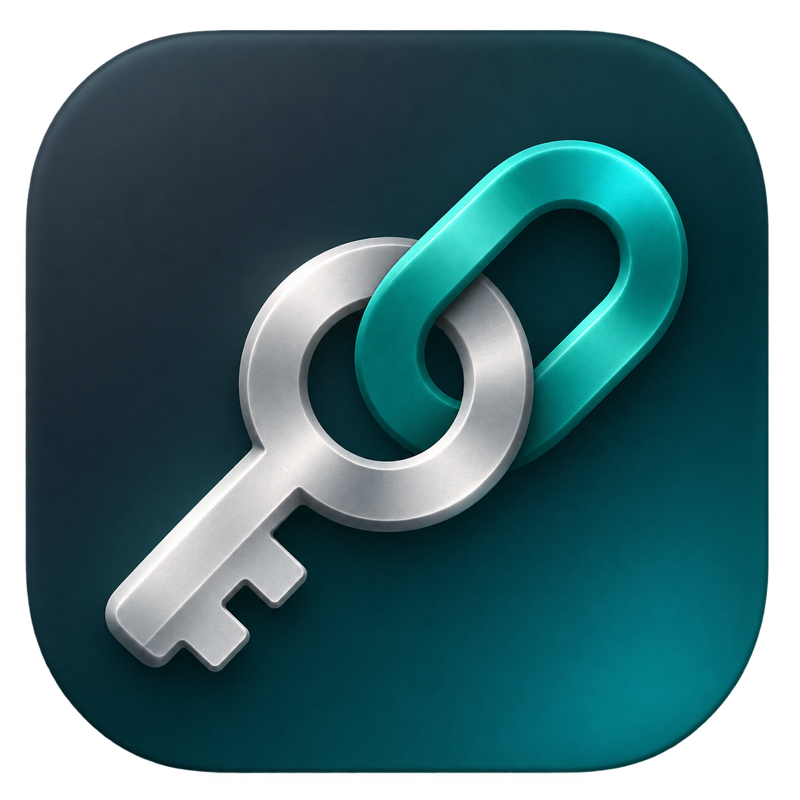

<p align="center">
  
</p>

# Keychain Compatibility Layer

[English](README.md) | [한국어](README.ko.md) | [简体中文](README.zh-CN.md) | [日本語](README.ja.md)

用于处理 Codex 远程控制设备密钥创建错误的 macOS 兼容层。
它将 Codex 连接到软件支持的钥匙串存储，不修改或复制原始 Codex 应用。

**目前支持 Codex 自动兼容，以及 Secretive 的独立 SSH 密钥。**
通过 CryptoTokenKit 智能卡接口连接 Secretive，不修改其原始应用。
这不是所有应用的通用钥匙串修复工具，也不模拟 Secure Enclave 硬件。

## 支持的应用

| 应用 | 功能 | 已验证版本 |
| --- | --- | --- |
| Codex | 设备密钥创建兼容 | 26.1111.21308 |
| Secretive | SSH 密钥创建与签名 | 4.0.0 |

验证环境：macOS 26.7.3（Intel）。当前 KCL：0.5.1。
Secretive 密钥在 KCL 中创建；签名时需要两次认证。
[详细验证记录与限制](docs/VERIFICATION.md)。

## 包结构

| 包 | 职责 |
| --- | --- |
| `native/core/` | 密钥存储、认证、签名 |
| `native/integrations/codex/` | Codex 自动兼容 |
| `native/integrations/secretive/` | Secretive SSH 密钥 |

作为一个应用和 DMG 分发。[详细结构](docs/ARCHITECTURE.md)。

## 何时使用

```text
Secure Enclave key creation failed
OS-protected fallback failed
OSStatus error -25293
```

**当 Codex 远程控制授权在创建设备密钥时失败，且日志出现上述错误链时，
才使用此兼容层。** 某些较旧的 macOS 版本可能报告 `-25300`。
不要仅凭错误编号判断；请确认错误发生在远程控制设备密钥的创建过程中。

这通常影响无法使用 Secure Enclave 的环境，例如不带 T2 芯片的旧款
Intel Mac 和黑苹果（Hackintosh）。**并非所有 Intel Mac 或黑苹果都需要
此工具。** 当前运行时集成面向 Intel（`x86_64`）macOS。上述示例仅表示
可能受影响的环境，并不代表所有机型、系统或应用版本均经过测试。

**以下情况无需使用：**

- Codex 远程控制授权已经可以正常完成。
- 连接失败源于账户或工作区不匹配、网络、管理员策略等与设备密钥创建无关的原因。
- 需要通用钥匙串修复、Touch ID、硬件证明，或替代 Secure Enclave 硬件本身。

此兼容层仅处理 Codex 的特定软件密钥操作，不会替代所有应用的钥匙串访问。
所需的浏览器授权和 macOS 身份验证仍须手动完成。如果官方更新修复了问题，
请先停用此兼容层并验证正常授权，再停止使用。

## 下载和安装

从本仓库 GitHub **[Releases](https://github.com/hoyaaaa/keychain-compatibility-layer/releases)** 下载**预先构建的 Intel macOS DMG**。
用户无需安装 **Homebrew、Go、Python、Xcode，也无需编译源码**。
文件名为 `Keychain-Compatibility-Layer-0.5.1-macOS-x86_64.dmg`，并提供匹配的
`.sha256` 校验文件。目前仅面向 Intel macOS，不是包含 Apple Silicon 的通用构建。

1. 下载并打开 DMG。
2. 打开其中的 **Keychain Compatibility Layer.app**，点击 **Install / 설치**。
3. 安装后的应用立即开始自动应用；保持应用运行即可，菜单栏会显示 **KCL**。
4. 推出 DMG；以后使用原来的 Codex 图标启动。

应用安装到 `~/Applications/Keychain Compatibility Layer.app`。
安装程序执行签名验证、暂存复制、失败回滚，并保留现有密钥。
自动应用仅在本应用运行时工作，没有独立的登录服务或启用开关；不会关闭已经运行的 Codex；下次正常启动 Codex 时，
会正常重启一次以加载兼容层。所需的浏览器批准和 macOS 认证仍须由用户完成。

**首次打开：**此测试预发行版仅使用临时签名，**未经 Apple 公证**，因此 macOS 可能显示警告或阻止运行。如果你信任此下载，请先尝试打开应用并关闭警告，然后前往**系统设置 → 隐私与安全性 → 仍要打开**，完成身份验证，并在提示时点击**打开**。[Apple 说明](https://support.apple.com/zh-cn/102445)。

## 为 Secretive 创建 SSH 密钥

1. 打开 KCL，在菜单中选择 **Create SSH key for Secretive… / SSH 키 만들기…**。
2. 输入名称，创建独立的软件 RSA-2048 密钥并复制公钥。
3. 打开或重启原版 Secretive；密钥显示在智能卡分类中。
4. 按 Secretive 自身的说明配置 SSH 代理套接字。签名仍须完成 macOS 用户认证。

Secretive 原有的 Secure Enclave 创建按钮保持不变；软件密钥在 KCL 中创建。
不会复用或替换 Codex 的 P-256 设备密钥。KCL 使用一个共享令牌发布公钥，以适应
Secretive 只选择首个令牌的限制。其他 KCL 密钥也可能显示；SSH 只使用 **SSH — …** 密钥。
如连接了其他智能卡且 Secretive 选中了它，请断开该卡并重启 Secretive。

当前使用 **RSA-2048 / RSA-SHA2-512**，与 Secretive 支持的算法匹配。
公钥中的 `ssh-rsa` 是密钥编码名称，不表示启用 SHA-1 签名。测试的 Secretive 构建
无法正确验证 ECDSA 智能卡 SSH 签名，因此此路径不生成 ECDSA 密钥。
不模拟 Secure Enclave、Touch ID 或硬件保护。[技术说明（英文）](docs/SECRETIVE.md)。

**当前限制：**Secretive 和 KCL 分别认证，签名时可能询问两次密码。本版本保留两项检查，不绕过认证。

## 更新或关闭

打开新版本 DMG 中的应用，再次点击 **Install / 설치** 即可更新。
安装程序保留旧应用、已有密钥和自动应用服务原有的运行状态。完成后推出 DMG。

在菜单栏选择 **KCL → Quit / 종료** 即可停止自动应用，
然后完全退出 Codex 并正常重新打开，即可停止使用兼容层。密钥和 Codex 原件保持不变。强制退出本应用后监视进程也会停止；重新打开应用即可恢复。已经载入 Codex 的代码会保留至 Codex 退出。

## 开发和发布

版本 **0.5.1** 统一记录在 `VERSION`。维护者推送匹配的 `v0.5.1` 标签后，
CI 检查版本、运行测试、构建并验证 DMG，然后将 DMG 和 SHA-256 上传到 GitHub
测试预发行版。手动运行工作流只生成 CI 构件，不发布 Release。

构建、测试和发布步骤见[贡献指南（英文）](CONTRIBUTING.md)；可选诊断见
[技术文档（英文）](docs/TECHNICAL.md)；改动见[更新记录](CHANGELOG.md)。
内部可执行文件、Bundle ID、类名和运行目录统一使用 Keychain Compatibility Layer / KCL。升级迁移会验证公钥身份一致；旧标识符仅用于迁移，旧加密密钥项保留用于恢复。从旧命名空间升级后，请完全退出并重启 Codex。

[MIT 许可证](LICENSE) · [贡献指南（英文）](CONTRIBUTING.md)
